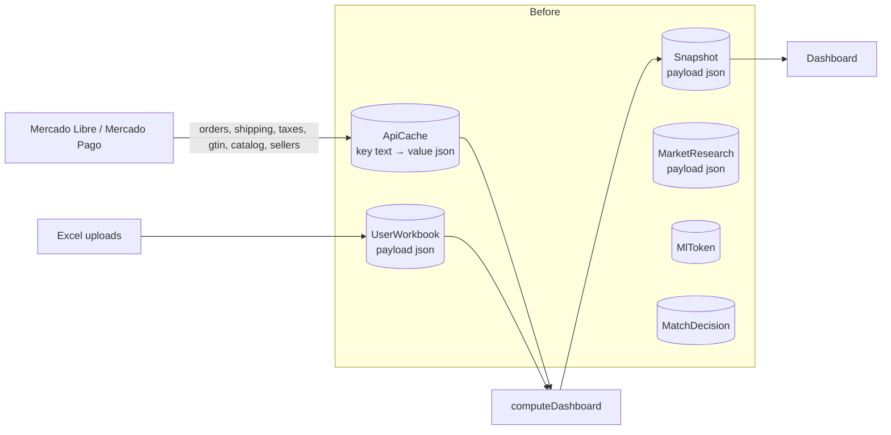

# Database analysis (2026-11-12)

An audit of the database as it was before migration `20261112000000_normalize_schema`, written to justify the new design. Each finding has evidence, the effect on the product goal (**show up-to-date statistics with the most specific detail possible**), and its status.

Status legend: **Fixed** = solved by this change, **Open** = not done, **Verify** = needs a business answer before acting.

## 1. What existed

Six tables, all keyed by `ownerId` (Clerk user id) with no relation between them and no table for the user:

| Table | Rows (benchmark dataset: 1 user, 120k orders) | What it really held |
|---|---|---|
| `ApiCache` | **246,022** | Six unrelated things, told apart only by a key prefix: `orders:YYYY-MM`, `ship3:<id>`, `tax:<id>`, `gtin:<item>`, `catalog:<item>`, `seller:<id>` |
| `Snapshot` | 22 (one per month) | The whole computed dashboard of a month as one JSON, including every sale line (`rows`) |
| `UserWorkbook` | 2 per user (one per file kind) | The parsed Excel files as one JSON each |
| `MlToken` | 1 per user | OAuth tokens |
| `MatchDecision` | a few per user | Person's yes/no on title matches |
| `MarketResearch` | 1 per catalog product | The last scatter of offers as one JSON, overwritten on refresh |

The benchmark dataset is synthetic (section 2.B). The real production volume was not available to this analysis; the local development database holds 848 `ApiCache` rows of demo data. Re-run the measurements on production data before quoting absolute numbers.

## 2. Findings

### A. Structure and modelling

| # | Finding | Evidence | Why it hurts | Status |
|---|---|---|---|---|
| A1 | `ApiCache` is a God table: six concerns, one `(ownerId, key)` primary key, untyped `value` | `src/server/sync/enrich.ts` (`ship3:`, `gtin:`, `catalog:`, `tax:`, `orders:`), `src/server/ml/market.ts` (`seller:`) | No types, constraints or relations; every read/write goes through string keys; nothing can be joined or filtered by content; statistics are impossible without loading JSON | **Fixed**: split into `Listing`, `ListingVariation`, `Shipment`, `Order`, `OrderItem`, `OrderPayment`, `OrderPeriod`, `Payment`, `PaymentTax`, `Seller` |
| A2 | A month of orders is **one JSON row** (`orders:YYYY-MM`) holding every order, item and payment | measured: one row per month; 5,400 orders = 2.1 MB of JSON text (188 kB compressed on disk), parsed in full on every read | Orders cannot be queried by item, status, date or payment; every history rebuild loads and parses every month; the **current month is never stored at all** (it is re-downloaded each time) | **Fixed**: `Order` / `OrderItem` / `OrderPayment`; current month persisted too |
| A3 | `Snapshot.payload` contains all sale lines (`rows`) plus stock, suggestions and comparison | `DashboardDataSchema` in `src/lib/contracts.ts` | The only per-line economics live inside a JSON the UI downloads whole; any new statistic means parsing it in JS | **Fixed** (added) / **Open** (slimming): lines are now also stored in `SaleLine`; `Snapshot` still carries `rows` for the current UI. Next step: serve tables from `SaleLine` and drop `rows` from the snapshot |
| A4 | The Excel data is stored as JSON blobs (`UserWorkbook`) | `src/server/workbooks/store.ts` (old version) | `listUploads` parsed and Zod-validated the **entire payload just to count rows**; the product base, mappings, direct sales and restocking cannot be joined with sales | **Fixed**: `Upload`, `Product`, `PnlClosing`, `CostOverride`, `ProductMapping`, `DirectSale`, `StockReceipt`; row counts stored |
| A5 | Market research is overwritten on each refresh | `prismaMarketStore.save` was an upsert on `(ownerId, catalogProductId)` | The history of competitor prices, the most valuable market signal, is destroyed every 15 minutes | **Fixed**: `MarketScan` + `MarketOffer` keep every scan (90-day retention) |
| A6 | No tenant table, no foreign keys; nothing says which marketplace an id belongs to | schema | Deleting a user means hand-written deletes across tables; orphans are possible; nothing stops a row pointing at another tenant's data | **Fixed**: `Account` root, composite FKs `(accountId, …)`, cascades. Verified by a test that deletes an account |
| A7 | Free text where there is a closed set | `decision`, `kind` were `String`; `month` was `String` | Typos persist silently | **Fixed**: enums (`MatchVerdict`, `UploadKind`, `MappingKind`, `Channel`, `OfferExclusion`), `char(7)` + `CHECK` on months |
| A8 | "Asked and found nothing" encoded as JSON `null` inside a JSON column | `Prisma.JsonNull` in `writeCache` | SQL cannot tell "never asked" from "asked, none" without parsing; easy to confuse (`null` vs `DbNull` vs `JsonNull`) | **Fixed**: explicit `*CheckedAt` / `*FetchedAt` columns plus nullable value |
| A9 | Key versioning leaks rows | three generations of the shipping key exist: the code reads only `ship3:`, while the real dump holds 1,938 dead `ship:` and 2,900 dead `ship2:` rows (a third of the cache) | Dead data forever; a semantic change means a new key, not a migration | **Fixed**: not migrated; typed columns can be altered with a normal migration |
| A10 | Documentation drift | the schema comment still said `ship:<id>` while code used `ship3:` | Comments lie | **Fixed**: `docs/database/SCHEMA.md` is generated from the schema and a test fails when it is stale |
| A11 | `TIMESTAMP(3)` without time zone | `MlToken`, `Snapshot`, … | Ambiguous instants | **Fixed** for every new column (`timestamptz`); `Snapshot` and `MatchDecision` converted in place (values were UTC) |
| A12 | OAuth tokens stored in plain text | `MlToken.accessToken/refreshToken` (now `MarketplaceConnection`) | A database leak is a credential leak (refresh tokens grant long-lived access to the seller account) | **Open**: encrypt at rest at the application layer (AES-GCM, key in env) |

### B. Write and read performance

Measured on this machine (Docker Postgres 16, one connection, median of 7 runs) with synthetic but realistic data: 1 account, 120,000 orders over ~22 months (~5.4k a month), 132,000 order lines, 120,000 payments with 3 tax lines each, 120,000 shipments, 3,000 listings, in **both** shapes. "Old" runs the previous code path against `ApiCache`/`Snapshot`; "new" runs the new store functions.

| Operation | Old | New | |
|---|---:|---:|---|
| Read one month of orders (5.4k) | 50 ms | 61 ms | about equal: a single blob row is cheap to fetch; the new read assembles 3 tables |
| Read 5,000 shipment costs | 49 ms | 17 ms | 2.9× |
| Read 5,000 payment taxes | 59 ms | 45 ms | 1.3× |
| Read GTINs of 3,000 listings | 33 ms | 9 ms | 3.8× |
| Own-product search over 3,000 listings | 25 ms | 0.6 ms | 40× (and no longer linear in listings) |
| Margin by category for a month | 45 ms | 2.6 ms | 17× (SQL on `SaleLine` vs parsing the snapshot JSON) |
| Write 500 shipment costs | 110 ms | 4.4 ms | 25× |
| Write 500 payment taxes (3 lines each) | 124 ms | 28 ms | 4.4× |
| Persist the month's 5.4k orders again, nothing changed | n/a (never stored) | 277 ms | skips unchanged rows; negligible next to the ~108 API pages it would take to download them |

Disk, same dataset: old `ApiCache` 53 MB; new Order/OrderItem/OrderPayment/Payment/PaymentTax/Shipment/Listing 124 MB (+ `SaleLine` 42 MB of derived data). **The normalized form is about 2.3× larger**: that is the price of having rows you can filter, join and keep incrementally, and it is the main trade-off of the design (see D1).

| # | Finding | Evidence | Status |
|---|---|---|---|
| B1 | One `upsert` per row inside a transaction | `writeCache` (500 per transaction), `apiCacheNicknames.set` | **Fixed**: one `INSERT … SELECT unnest(…) ON CONFLICT` per batch (arrays travel as a single bind parameter) |
| B2 | Reads use `key IN (5000 keys)` | `readCache` | **Fixed**: `= ANY($1::bigint[])` on the primary key |
| B3 | "Asked, nothing found" is asked **again on every sync, forever**: 12% of the payments in the demo data have no Mercado Pago tax detail and cost one API call each per sync; listings without a catalog product are re-asked likewise | `enrich.ts`: `(c ?? null) === null` and `if (!id) needCat.push(i)` | **Fixed** with time windows: no-detail payments again after 6 h (or while the order is < 2 days old), no-catalog listings after 24 h. A deliberate behaviour change |
| B4 | A history rebuild downloads every month from Mercado Libre: the month being rebuilt is passed as "current" (`closed=false`) | `runSync` called `fetchMonth(…, false, …)` for the forced month | **Fixed**: a month before the real current one is closed, so once final it is read from `Order` |
| B5 | `rebuildAll({ refetch })` deleted the whole cache, including titles, matches and nicknames, before re-downloading | `db.apiCache.deleteMany` | **Fixed**: marks fetch state stale; old values stay until new ones arrive, so an interrupted refetch loses nothing |
| B6 | Own-product search loads every `catalog:` row and filters in JS on each keystroke | `storedProducts` | **Fixed**: trigram index (`pg_trgm`) on `Listing.searchText`; the latest snapshot is parsed only if the page is not full |
| B7 | Concurrent writers (sync, rebuild, market refresh) hit the same rows in arbitrary order: deadlock risk | per-row upserts in loops | **Fixed**: bulk statements with a stable key order |
| B8 | Whole-JSON rewrites: each sync rewrites a `Snapshot` of 1.8 MB of JSON text for a 5.4k-line month and (conceptually) every month blob | `snapshot.upsert` | **Open**: slim the snapshot (A3) |
| B9 | Every refresh re-downloads the **whole** current month (50 orders per API page) | `ordersMonth` | **Open**, now unblocked: orders are persisted with `createdAt`, so an incremental sync (`order.date_last_updated.from`) can fetch only what changed |
| B10 | No retention anywhere | all tables | **Fixed** for `MarketScan` (90 days); **Open** for the rest (orders and lines are facts; revisit at ~50M rows with partitioning by month) |

### C. Things noticed in the business logic

| # | Observation | Status |
|---|---|---|
| C1 | **Packs.** An order's payments list could repeat the same Mercado Pago payment for several orders of a pack, and `buildLines` adds `taxes[payment].total` to each order. | **Checked on the real dump: not happening.** 3,306 of 4,148 orders carry a `packId`, yet 0 payments are shared between orders. Keep the query (`SELECT "paymentId", count(*) FROM "OrderPayment" GROUP BY 1 HAVING count(*) > 1`) as a periodic check |
| C2 | Shipping of orders that share a `shippingId` is split by revenue share (`shipRev`), correctly handled | OK |
| C3 | The financing fee is carved out of `sale_fee` using the payment's `financing` figure; entries cached before that feature have no `financing` and are re-asked once | Preserved (`Payment.financingFee` null with `taxTotal` set) |
| C5 | **Month-boundary orders are counted twice.** The real accounts' timestamps carry a `-04:00` offset, and Mercado Libre applies the month filter in that clock, so an order made minutes before midnight is delivered by two consecutive months' downloads. In the real dump, 7 orders appear in two month blobs (May+June, June+July, Aug+Sept). The old code kept both copies, so each month's dashboard counted them: 7 lines, ARS 815,894 of revenue across May, June and August, plus a shift in July's comparison base and tax calibration. | **Fixed** (behaviour change): an order belongs to the month of its own instant and is stored once. The old numbers were wrong by those lines |
| C6 | Real `date_created` values come with `-04:00` while the app treats Argentina as `-03:00`. The instants are converted correctly (`2026-05-31T23:34-04:00` is `2026-06-01 00:34` in Argentina), so dates shown are consistent, but it is worth confirming with Mercado Libre which clock the account is in | **Verify** |
| C4 | Calculations use JS doubles; the database stores `numeric(16,4)`. Results are identical to the cent in the equivalence test | OK |

### D. Costs and risks of the new design

| # | Trade-off | Mitigation |
|---|---|---|
| D1 | About 2.3× the disk of the JSON store; `PaymentTax` is the biggest table (45 MB for 360k lines) | Acceptable at this scale. If tax names are never queried, `PaymentTax` can collapse into a `jsonb` column on `Payment`. Decide with real usage |
| D2 | Three foreign keys are `DEFERRABLE INITIALLY DEFERRED` (`Order→Shipment`, `OrderItem→Listing`, `OrderPayment→Payment`) so deleting an `Account` can cascade. Prisma cannot express this | Documented in the migration; never regenerate these constraints from `migrate dev` output |
| D3 | The store layer uses raw SQL for bulk upserts, typed by hand | Covered by round-trip tests in `src/server/store/store.test.ts` |
| D4 | "Fetched at" stamps now come from the sync's clock (`now`), not the database's, so staleness decisions use one clock | Production clocks coincide; tests can control time |
| D5 | Orders created in the same instant come back ordered by id instead of API order | Real timestamps carry seconds/ms; ties only occur in demo data |
| D6 | `Snapshot` and `SaleLine` hold overlapping data until A3 is finished | Both are rebuilt by the same sync; `SaleLine` is the one new statistics should use |

## 3. Roadmap toward richer statistics

In order of payoff; none is implemented yet.

1. **Serve the dashboard tables from `SaleLine`** (paginated, filterable by date, category, listing) and drop `rows` from `Snapshot`.
2. **`SyncRun`**: one row per sync (duration, API calls, orders fetched, error). Today `lastError` lives in process memory and is lost on restart.
3. **Listing price and stock history** (`ListingSnapshot`): to correlate price changes with sales and with the competitor scans already kept.
4. **Scheduled market scans** for every catalog product we sell, so price history exists without anyone opening the page; chart price vs units sold.
5. **Product cost history**: version `Product` by close so margin per product can be trended (today an upload replaces it).
6. **Richer shipment facts**: the client already reads `logistic_type`, cost and the Flex bonus separately; store them instead of only the net.
7. **Refunds and cancellations ledger** (status changes over time) to separate gross from net sales.
8. **Buyer geography** (province / postal code) for regional demand, if Mercado Libre returns it for the account (check privacy terms first).
9. **Daily aggregate table** (`SaleDaily`, refreshed per sync) once dashboards over multi-year ranges get slow; **partition** `SaleLine`/`OrderItem` by month beyond ~50M rows.
10. **Encrypt tokens at rest** (A12) and consider row-level security as defence in depth.
