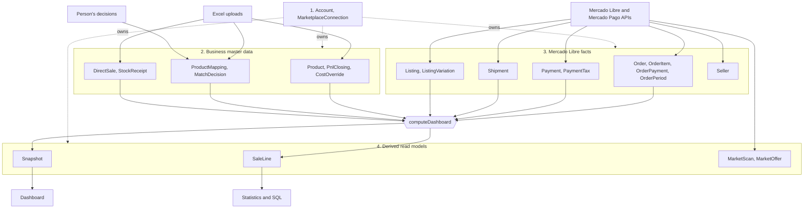

# Database

PostgreSQL 16, managed with Prisma (`prisma/schema.prisma`, migrations in `prisma/migrations/`). One database serves many users: every business row belongs to an `Account` (the Clerk user id).

| Document | What it is | Maintained |
|---|---|---|
| [SCHEMA.md](SCHEMA.md) | ER diagrams per domain, every table and column, indexes, foreign keys | **Generated** from `schema.prisma` (`pnpm db:docs`) |
| [ANALYSIS.md](ANALYSIS.md) | Audit that led to the current design: findings, measurements, trade-offs, roadmap | By hand, dated |
| [MIGRATION.md](MIGRATION.md) | Where each legacy row went, safeguards, rollout, rollback, the drop step | By hand, per migration |
| [CHANGELOG.md](CHANGELOG.md) | One entry per migration | By hand, **enforced by a test** |
| [cookbook.sql](cookbook.sql) | Ready-made statistics queries | By hand |

## The shape of the data

Four layers, in the order a fact travels through them:



- **Facts** are written by the sync with idempotent bulk upserts and never recomputed.
- **Master data** is replaced as a whole by each Excel upload; decisions are never overwritten by an upload.
- **Derived** tables can be dropped and rebuilt ("Recalcular histórico"). `SaleLine` is the table to query for statistics (margin = `revenue - marketplaceCost - cogs`); `Snapshot` is only what the dashboard UI receives.

## Who writes what

| Code | Tables |
|---|---|
| `fetchMonth` → `saveOrders` (`src/server/store/orders.ts`) | `Order`, `OrderItem`, `OrderPayment`, `OrderPeriod`; stubs in `Listing`, `Shipment`, `Payment` |
| `enrich` (`src/server/sync/enrich.ts`) | `Shipment.sellerCost`, `Listing` (GTIN, catalog id) + `ListingVariation`, `Payment` tax columns + `PaymentTax` |
| end of `runSync` (`src/server/sync/run.ts`) | `Listing` (title, matched EAN, search text), `SaleLine`, `Snapshot` |
| `POST /api/upload`, `deleteUpload` (`src/server/workbooks/store.ts`) | `Upload`, `Product`, `PnlClosing`, `CostOverride`, `ProductMapping`, `DirectSale`, `StockReceipt`; drops the current month's `Snapshot` |
| `decideMatch` (`src/server/sync/matches.ts`) | `MatchDecision` |
| OAuth callback and token refresh (`src/server/ml/tokens.ts`) | `MarketplaceConnection` |
| market `touch` (`src/server/market/service.ts`) | `MarketScan`, `MarketOffer`, `Seller` |
| `rebuildAll({ refetch })` | marks `OrderPeriod`, `Shipment`, `Payment`, `Listing` fetch state stale |

All database access for Mercado Libre data goes through `src/server/store/`. Do not add queries on those tables elsewhere.

## Conventions

- **Tenant first.** `accountId` is the first column of every business primary key; composite foreign keys `(accountId, …)` make cross-tenant references impossible.
- **Money.** Amounts from Mercado Libre / Mercado Pago and derived amounts are `numeric(16,4)` (ARS). Weighted costs and ratios read from the user's Excel are `double precision`.
- **Time.** Instants are `timestamptz`; calendar days are `date`; months are `char(7)` `YYYY-MM` in the Argentine calendar (UTC-3, no DST). Stamps like `*FetchedAt` come from the sync's clock.
- **Marketplace.** Ids a marketplace assigns (orders, listings, payments, shipments, sellers) are `bigint`/text and always keyed together with `marketplace`; ids from different marketplaces can collide. Master data (products, costs, direct sales) is marketplace-neutral. Item ids are stored upper-case.
- **A new marketplace** = a value in the `Marketplace` enum (a migration), a `DataSource` that declares it, and a connector that writes the same tables. Nothing else in the schema changes.
- **"Asked, found nothing"** is a nullable value plus a `*CheckedAt` / `*FetchedAt` column set, never a sentinel.
- **JSON** only for derived read models (`Snapshot.payload`, `MarketScan.regression`), never for facts that statistics filter, join or aggregate.
- **Bulk writes** are one `INSERT … SELECT unnest(…) ON CONFLICT` per batch, sorted by key, skipping unchanged rows.

## Statistics

`cookbook.sql` has ten queries that were impossible or slow before: daily trend, cost breakdown per category, best/worst listings with match quality, unmatched revenue share, orders by hour, taxes by type, shipping cost by week, competitor price history, our price vs the market, and month finality.

## Commands

```bash
pnpm db:docs                                  # regenerate SCHEMA.md after editing schema.prisma
pnpm prisma migrate dev --name <what_changed> # create a migration from schema.prisma changes
pnpm prisma migrate deploy                    # apply migrations (the Dockerfile does it on start)
scripts/test-migration.sh                     # rehearse the data migration on a throwaway database
pnpm test                                     # includes the documentation checks
```

Tests that use the database read `TEST_DATABASE_URL` (default: the `pnl_t6` database of `scripts/create-db.sh`). Create one with `scripts/create-db.sh <name>` and export the URL.

## Changing the schema

1. Edit `prisma/schema.prisma`. Give every new model and every non-obvious column a `///` comment: that text becomes the data dictionary.
2. `pnpm prisma migrate dev --name <what_changed>`. Review the SQL. If existing rows must move, write the `INSERT … SELECT` in the same migration and end it with a verification block (see `20261112000000_normalize_schema` for the pattern), and add a fixture test under `prisma/migration-tests/`.
3. Add the entry to [CHANGELOG.md](CHANGELOG.md): what changed, what the code must do differently, rollout.
4. `pnpm db:docs` and commit `SCHEMA.md`.
5. Put new reads and writes in `src/server/store/` with a round-trip test in `store.test.ts`.
6. If the change alters the overall picture (a new layer, a new writer), update the diagram and the "Who writes what" table above.

## How the documentation stays correct

These fail the test suite (`src/server/store/docs.test.ts`), so they cannot rot silently:

- `SCHEMA.md` must equal what `pnpm db:docs` generates from the current schema.
- Every model must have a `///` description.
- Every migration folder must be named in `CHANGELOG.md`.
- Nothing under `src/` may use the deprecated tables.

What no test can check is whether the hand-written files are still true; review `ANALYSIS.md` (dated) and this README whenever a layer changes.
