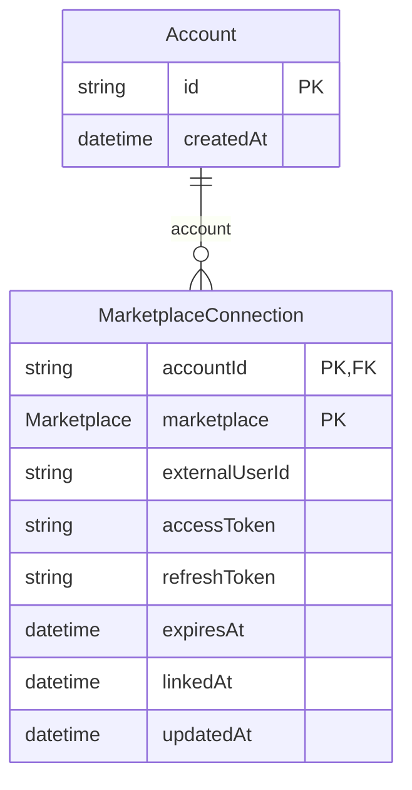
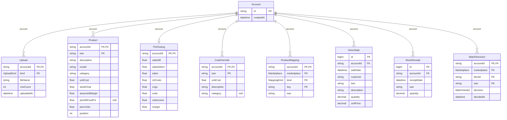
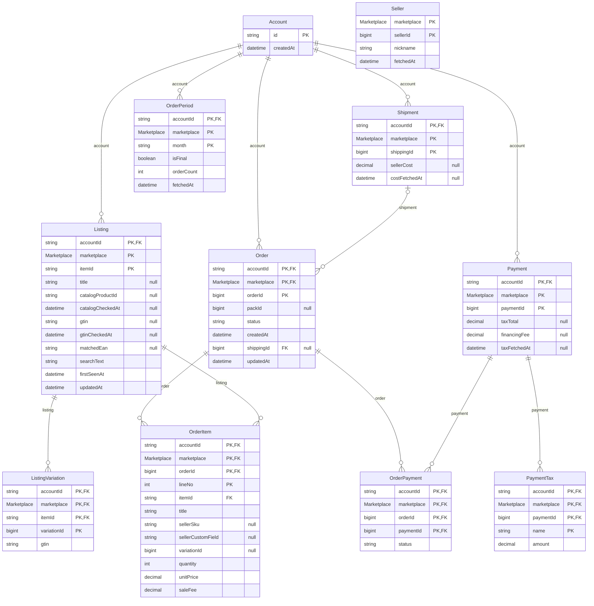
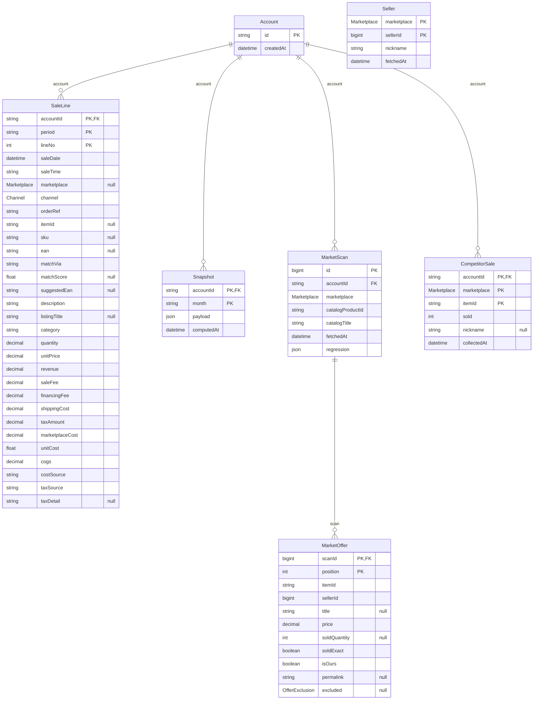

<!-- GENERATED FILE: do not edit. Source: prisma/schema.prisma. Regenerate with `pnpm db:docs`. -->

# Database schema

38 tables in 5 domains (PostgreSQL, managed with Prisma). Diagrams and the data dictionary below are generated from `prisma/schema.prisma`; the reasoning behind the design is in [ANALYSIS.md](ANALYSIS.md) and the history of changes in [CHANGELOG.md](CHANGELOG.md).

Reading the diagrams: `||--o{` is one-to-many, `||--o|` one-to-one, `PK`/`FK` mark key columns, `null` marks nullable columns. Every business table carries `accountId` as the first column of its primary key.

## 1. Tenancy and connection

Who the data belongs to and how the app reaches each marketplace on their behalf.

### Data dictionary

#### Account

A signed-in user (Clerk user id). Deleting an Account deletes everything it owns.

| Column | Type | Null | Key | Description |
|---|---|---|---|---|
| `id` | string |  | PK | Clerk user id (`user_...`). |
| `createdAt` | timestamptz(3) |  |  | First time the app saw this user (or the oldest legacy row, for migrated users). |

#### MarketplaceConnection

The user's OAuth link to one marketplace (replaces MlToken). Refresh tokens are single use, so the row is rewritten on every refresh. One row per account and marketplace.

| Column | Type | Null | Key | Description |
|---|---|---|---|---|
| `accountId` | string |  | PK FK |  |
| `marketplace` | enum Marketplace |  | PK |  |
| `externalUserId` | string |  |  | The seller's id inside the marketplace (for Mercado Libre: the `seller` filter of every orders query). |
| `accessToken` | string |  |  | Short-lived bearer token (refreshed when it expires in < 5 min). |
| `refreshToken` | string |  |  | Single-use token that mints the next pair. |
| `expiresAt` | timestamptz(3) |  |  | When `accessToken` stops being valid. |
| `linkedAt` | timestamptz(3) |  |  | When the user linked their account. |
| `updatedAt` | timestamptz(3) |  |  |  |

Foreign keys: `(accountId)` → `Account` (on delete Cascade).

## 2. Business master data (Excel uploads and person decisions)

What the business knows and Mercado Libre does not: product costs, previous close, mappings, direct sales, restocking, and the yes/no answers on title matches. Replaced by each upload, never overwritten by a sync.

### Data dictionary

#### Upload

Metadata of the last file uploaded per kind. The raw .xlsx is never kept; it is parsed into the tables below inside one transaction.

| Column | Type | Null | Key | Description |
|---|---|---|---|---|
| `accountId` | string |  | PK FK |  |
| `kind` | enum UploadKind |  | PK | `pnl` = closing P&L (products + previous totals); `inputs` = direct sales, mappings, overrides, restocking. |
| `fileName` | string |  |  | Name of the file as uploaded (display only). |
| `rowCount` | int |  |  | Products in a `pnl` file, direct-sale rows in an `inputs` file (shown in the UI). |
| `uploadedAt` | timestamptz(3) |  |  |  |

Foreign keys: `(accountId)` → `Account` (on delete Cascade).

#### Product

A product of the user's P&L close ("base"): one row per EAN. Replaced as a whole by each "pnl" upload. Costs are weighted averages (ratios), hence Float.

| Column | Type | Null | Key | Description |
|---|---|---|---|---|
| `accountId` | string |  | PK FK |  |
| `ean` | string |  | PK | EAN-13 of the product (the join key to listings through GTIN / mapping). |
| `description` | string |  |  | Product name in the Excel ("Descripción"). |
| `model` | string |  |  | Model column of the Excel. |
| `category` | string |  |  | SONY, PLAY STATION, XBOX, BOSCH, VINOS, ONFAN or OTRAS. |
| `unitCost` | float |  |  | "CU Pond.": weighted average unit cost of the close. |
| `stockFinal` | float |  |  | Final stock of the close = initial stock of the month being tracked. |
| `assumedMargin` | float |  |  | "Mg asum.": margin assumed when no real cost exists (0..1). |
| `prevMlCostPct` | float | null |  | Marketplace cost as a fraction of sales in the previous close (null when unknown). |
| `prevUnits` | float |  |  | Units sold in the previous close (consumption-rate fallback). |
| `position` | int |  |  | Row order in the uploaded file; ties in the stock ranking fall back to it. |

Foreign keys: `(accountId)` → `Account` (on delete Cascade).

Extra indexes: `(accountId, category)`.

#### PnlClosing

Totals of the previous close, used to calibrate the tax estimate and as the comparison base.

| Column | Type | Null | Key | Description |
|---|---|---|---|---|
| `accountId` | string |  | PK FK |  |
| `salesMl` | float |  |  | Sales through Mercado Libre in the previous close. |
| `salesDirect` | float |  |  | Direct sales in the previous close. |
| `sales` | float |  |  | Total sales. |
| `mlCosts` | float |  |  | Marketplace costs (fees + shipping + taxes) charged by Mercado Libre. |
| `cogs` | float |  |  | Cost of goods sold. |
| `units` | float |  |  | Units sold. |
| `netIncome` | float |  |  | Net income after marketplace costs. |
| `margin` | float |  |  | Gross margin of the close. |

Foreign keys: `(accountId)` → `Account` (on delete Cascade).

#### CostOverride

"Override" sheet: a person-set unit cost for an EAN that wins over the close.

| Column | Type | Null | Key | Description |
|---|---|---|---|---|
| `accountId` | string |  | PK FK |  |
| `ean` | string |  | PK | Product the override applies to (may not be in `Product`). |
| `unitCost` | float |  |  | Unit cost to use instead of the close's weighted cost. |
| `description` | string |  |  | Description to show when the product is not in the close. |
| `category` | string | null |  | Category to use; null = keep the product's. |

Foreign keys: `(accountId)` → `Account` (on delete Cascade).

#### ProductMapping

"Mapeo ML" / "Mapeo SKU" sheets: listing id or seller SKU -> EAN. Replaced by each "inputs" upload.

| Column | Type | Null | Key | Description |
|---|---|---|---|---|
| `accountId` | string |  | PK FK |  |
| `marketplace` | enum Marketplace |  | PK | Marketplace the ids of this row belong to (ids from different marketplaces can collide). |
| `kind` | enum MappingKind |  | PK | `item` = Mercado Libre listing id, `sku` = seller SKU. |
| `key` | string |  | PK | The listing id or SKU being mapped. |
| `ean` | string |  |  | EAN it maps to. |

Foreign keys: `(accountId)` → `Account` (on delete Cascade).

Extra indexes: `(accountId, marketplace, ean)`.

#### DirectSale

"Ventas directas" sheet: sales made outside Mercado Libre.

| Column | Type | Null | Key | Description |
|---|---|---|---|---|
| `id` | bigint |  | PK |  |
| `accountId` | string |  | FK |  |
| `saleDate` | date |  |  | Day of the sale. |
| `customer` | string |  |  | Customer name as written in the sheet. |
| `ean` | string |  |  | Product sold. |
| `description` | string |  |  | Description as written in the sheet. |
| `quantity` | decimal(14,3) |  |  | Units. |
| `unitPrice` | decimal(16,4) |  |  | Price per unit (ARS). |

Foreign keys: `(accountId)` → `Account` (on delete Cascade).

Extra indexes: `(accountId, saleDate)`, `(accountId, ean)`.

#### StockReceipt

"Ingresos" sheet: stock received (restocking) per EAN and day.

| Column | Type | Null | Key | Description |
|---|---|---|---|---|
| `id` | bigint |  | PK |  |
| `accountId` | string |  | FK |  |
| `receiptDate` | date |  |  | Day the stock arrived. |
| `ean` | string |  |  | Product restocked. |
| `quantity` | decimal(14,3) |  |  | Units received. |

Foreign keys: `(accountId)` → `Account` (on delete Cascade).

Extra indexes: `(accountId, receiptDate)`, `(accountId, ean)`.

#### MatchDecision

A person's yes/no on a title-similarity suggestion. Survives Excel re-uploads (unlike the mapping sheet). `itemId` and `ean` are soft references on purpose: both come from outside (Mercado Libre, Excel) and can disappear between uploads without invalidating the decision.

| Column | Type | Null | Key | Description |
|---|---|---|---|---|
| `accountId` | string |  | PK FK |  |
| `marketplace` | enum Marketplace |  | PK | Marketplace the ids of this row belong to (ids from different marketplaces can collide). |
| `itemId` | string |  | PK | Listing id (upper case). |
| `ean` | string |  | PK | EAN the person answered about. |
| `decision` | enum MatchVerdict |  |  | `confirmed`: use this EAN for the listing. `rejected`: never suggest or auto-match it again. |
| `decidedAt` | timestamptz(3) |  |  | When the person answered. |

Foreign keys: `(accountId)` → `Account` (on delete Cascade).

Extra indexes: `(accountId, marketplace, itemId)`.

## 3. Marketplace facts

What a marketplace API returns, normalized: listings, orders and their lines, payments with their taxes, shipments, seller nicknames. Every table carries `marketplace` in its key (ids from different marketplaces can collide). Written by the sync with idempotent bulk upserts; the order tables also record which months are final.

### Data dictionary

#### Listing

One of the user's listings ("publicación"). Holds what used to live in the `gtin:` and `catalog:` ApiCache keys, plus the link to the P&L product found by the matcher.

| Column | Type | Null | Key | Description |
|---|---|---|---|---|
| `accountId` | string |  | PK FK |  |
| `marketplace` | enum Marketplace |  | PK | Marketplace the ids of this row belong to (ids from different marketplaces can collide). |
| `itemId` | string |  | PK | Mercado Libre listing id (`MLA...`), upper case. |
| `title` | string | null |  | Current listing title (null for listings only known through a search). |
| `catalogProductId` | string | null |  | ML `catalog_product_id`; null with `catalogCheckedAt` set = "asked, listing has none". |
| `catalogCheckedAt` | timestamptz(3) | null |  |  |
| `gtin` | string | null |  | Item-level GTIN; null with `gtinCheckedAt` set = "asked, no GTIN". |
| `gtinCheckedAt` | timestamptz(3) | null |  |  |
| `matchedEan` | string | null |  | EAN of the P&L product this listing was matched to (soft reference to Product.ean). |
| `searchText` | string |  |  | Lower-cased, accent-free "title + P&L description" for the own-product search. |
| `firstSeenAt` | timestamptz(3) |  |  |  |
| `updatedAt` | timestamptz(3) |  |  | Last time a column other than `firstSeenAt` changed (no-op syncs do not touch it). |

Foreign keys: `(accountId)` → `Account` (on delete Cascade).

Extra indexes: `(accountId, marketplace, catalogProductId)`, `Gin (searchText)`.

#### ListingVariation

GTIN of one variation of a listing.

| Column | Type | Null | Key | Description |
|---|---|---|---|---|
| `accountId` | string |  | PK FK |  |
| `marketplace` | enum Marketplace |  | PK FK | Marketplace the ids of this row belong to (ids from different marketplaces can collide). |
| `itemId` | string |  | PK FK |  |
| `variationId` | bigint |  | PK | Mercado Libre variation id. |
| `gtin` | string |  |  | GTIN/EAN/UPC of the variation. |

Foreign keys: `(accountId, marketplace, itemId)` → `Listing` (on delete Cascade).

#### Seller

Public seller nicknames per marketplace. Global (not per tenant): a nickname is public data.

| Column | Type | Null | Key | Description |
|---|---|---|---|---|
| `marketplace` | enum Marketplace |  | PK | Mercado Libre seller id. |
| `sellerId` | bigint |  | PK |  |
| `nickname` | string |  |  | Public nickname. |
| `fetchedAt` | timestamptz(3) |  |  | When the nickname was read. |

#### Shipment

Shipment cost charged to (positive) or credited to (negative) the seller. A row exists as soon as an order references the shipment; `costFetchedAt` null = cost not asked yet.

| Column | Type | Null | Key | Description |
|---|---|---|---|---|
| `accountId` | string |  | PK FK |  |
| `marketplace` | enum Marketplace |  | PK | Marketplace the ids of this row belong to (ids from different marketplaces can collide). |
| `shippingId` | bigint |  | PK | Mercado Libre shipment id. |
| `sellerCost` | decimal(16,4) | null |  | Net cost for the seller: positive = charged, negative = credited (Flex bonus). |
| `costFetchedAt` | timestamptz(3) | null |  | When `sellerCost` was read from the API; null = not asked yet. Shipments of orders < 3 days old are asked again. |

Foreign keys: `(accountId)` → `Account` (on delete Cascade).

#### Order

A marketplace order, current month included. It belongs to the month of its own `createdAt` (Argentine calendar), whichever download delivered it. Read back ordered by (createdAt, orderId).

| Column | Type | Null | Key | Description |
|---|---|---|---|---|
| `accountId` | string |  | PK FK |  |
| `marketplace` | enum Marketplace |  | PK FK | Marketplace the ids of this row belong to (ids from different marketplaces can collide). |
| `orderId` | bigint |  | PK | Mercado Libre order id. |
| `packId` | bigint | null |  | Pack the order belongs to (several orders paid together); null if none. |
| `status` | string |  |  | `paid`, `cancelled`, ... Only `paid` orders count as sales. |
| `createdAt` | timestamptz(3) |  |  | Creation instant (Argentina is UTC-3, no DST). |
| `shippingId` | bigint | null | FK | Shipment of the order; null for pick-up / digital. |
| `updatedAt` | timestamptz(3) |  |  | When this row was last rewritten (a sync only rewrites rows that actually changed). |

Foreign keys: `(accountId)` → `Account` (on delete Cascade); `(accountId, marketplace, shippingId)` → `Shipment` (on delete NoAction).

Extra indexes: `(accountId, createdAt)`, `(accountId, marketplace, shippingId)`.

#### OrderItem

A line of an order. `lineNo` is the position inside the order (ML gives no line id).

| Column | Type | Null | Key | Description |
|---|---|---|---|---|
| `accountId` | string |  | PK FK |  |
| `marketplace` | enum Marketplace |  | PK FK | Marketplace the ids of this row belong to (ids from different marketplaces can collide). |
| `orderId` | bigint |  | PK FK |  |
| `lineNo` | int |  | PK | 0-based position inside the order. |
| `itemId` | string |  | FK | Listing sold (upper case). |
| `title` | string |  |  | Title at the time of the sale (the listing title can change later). |
| `sellerSku` | string | null |  | SKU the seller set on the listing, if any. |
| `sellerCustomField` | string | null |  | Alternative SKU field, if any. |
| `variationId` | bigint | null |  | Variation sold, if the listing has variations. |
| `quantity` | int |  |  | Units sold. |
| `unitPrice` | decimal(16,4) |  |  | Price per unit (ARS). |
| `saleFee` | decimal(16,4) |  |  | Marketplace fee per unit (includes the financing fee, see Payment.financingFee). |

Foreign keys: `(accountId, marketplace, orderId)` → `Order` (on delete Cascade); `(accountId, marketplace, itemId)` → `Listing` (on delete NoAction).

Extra indexes: `(accountId, marketplace, itemId)`.

#### Payment

A Mercado Pago payment and the taxes billed on it. A payment can be shared by several orders of a pack, hence the OrderPayment link table. `taxFetchedAt` null = never asked; set with `taxTotal` null = "asked, no detail available".

| Column | Type | Null | Key | Description |
|---|---|---|---|---|
| `accountId` | string |  | PK FK |  |
| `marketplace` | enum Marketplace |  | PK | Marketplace the ids of this row belong to (ids from different marketplaces can collide). |
| `paymentId` | bigint |  | PK | Mercado Pago payment id. |
| `taxTotal` | decimal(16,4) | null |  | Sum of the taxes billed to the seller on this payment. |
| `financingFee` | decimal(16,4) | null |  | "Costo por ofrecer cuotas"; part of the order items' saleFee. |
| `taxFetchedAt` | timestamptz(3) | null |  |  |

Foreign keys: `(accountId)` → `Account` (on delete Cascade).

#### PaymentTax

One tax charge of a payment (IVA, IIBB, SIRCREB...).

| Column | Type | Null | Key | Description |
|---|---|---|---|---|
| `accountId` | string |  | PK FK |  |
| `marketplace` | enum Marketplace |  | PK FK | Marketplace the ids of this row belong to (ids from different marketplaces can collide). |
| `paymentId` | bigint |  | PK FK |  |
| `name` | string |  | PK | Tax name as Mercado Pago reports it (e.g. `IIBB Retención CABA`). |
| `amount` | decimal(16,4) |  |  | Tax amount net of refunds (ARS). |

Foreign keys: `(accountId, marketplace, paymentId)` → `Payment` (on delete Cascade).

#### OrderPayment

Which payments settle which order, with the payment status as the order reports it.

| Column | Type | Null | Key | Description |
|---|---|---|---|---|
| `accountId` | string |  | PK FK |  |
| `marketplace` | enum Marketplace |  | PK FK | Marketplace the ids of this row belong to (ids from different marketplaces can collide). |
| `orderId` | bigint |  | PK FK |  |
| `paymentId` | bigint |  | PK FK |  |
| `status` | string |  |  | Payment status inside the order (`approved`, ...). Only approved payments count. |

Foreign keys: `(accountId, marketplace, orderId)` → `Order` (on delete Cascade); `(accountId, marketplace, paymentId)` → `Payment` (on delete NoAction).

Extra indexes: `(accountId, marketplace, paymentId)`.

#### OrderPeriod

Sync state of one month of orders: a closed month marked `isFinal` is read from Order/OrderItem and never downloaded again.

| Column | Type | Null | Key | Description |
|---|---|---|---|---|
| `accountId` | string |  | PK FK |  |
| `marketplace` | enum Marketplace |  | PK | Marketplace the ids of this row belong to (ids from different marketplaces can collide). |
| `month` | char(7) |  | PK | `YYYY-MM`, Argentine calendar. |
| `isFinal` | boolean |  |  | Closed month already re-downloaded after day 5 of the next month: never fetched again. |
| `orderCount` | int |  |  | Orders downloaded for the month. |
| `fetchedAt` | timestamptz(3) |  |  | When the month was last downloaded. |

Foreign keys: `(accountId)` → `Account` (on delete Cascade).

## 4. Derived read models

Rebuildable from sections 2 and 3. SaleLine is the table statistics should query; Snapshot is the dashboard exactly as the UI receives it; MarketScan/MarketOffer keep every pull of a catalog product's offers so prices can be charted over time.

### Data dictionary

#### SaleLine

One economics line (what `buildLines` computes): a sold order line or a direct sale, with the full marketplace cost breakdown. Rebuilt for a whole month on every sync. This is the table the statistics queries should hit: margin = revenue - marketplaceCost - cogs.

| Column | Type | Null | Key | Description |
|---|---|---|---|---|
| `accountId` | string |  | PK FK |  |
| `period` | char(7) |  | PK | `YYYY-MM` of the sale (same as `saleDate`). |
| `lineNo` | int |  | PK | Position in the month's sorted lines (date, time, channel). |
| `saleDate` | date |  |  | Day of the sale, Argentina time. |
| `saleTime` | varchar(5) |  |  | "HH:MM" Argentina time; empty for direct sales. |
| `marketplace` | enum Marketplace | null |  | `marketplace` or `direct` (venta directa). Marketplace the line was sold on; null for direct sales. |
| `channel` | enum Channel |  |  |  |
| `orderRef` | string |  |  | Pack/order id for marketplace lines, customer for direct sales. |
| `itemId` | string | null |  |  |
| `sku` | string | null |  |  |
| `ean` | string | null |  | P&L product the line was matched to; null = unmatched. |
| `matchVia` | string |  |  | How the EAN was found: "Mapeo item", "GTIN publicación", "Similitud de título", ... |
| `matchScore` | float | null |  |  |
| `suggestedEan` | string | null |  |  |
| `description` | string |  |  | Product description (Excel name when matched, listing title otherwise). |
| `listingTitle` | string | null |  |  |
| `category` | string |  |  | Product category, or `SIN MATCH` when unmatched. |
| `quantity` | decimal(14,3) |  |  | Units. |
| `unitPrice` | decimal(16,4) |  |  | Price per unit. |
| `revenue` | decimal(16,4) |  |  | quantity × unitPrice. |
| `saleFee` | decimal(16,4) |  |  | Selling fee, without the financing part. |
| `financingFee` | decimal(16,4) |  |  | Installment-offering fee. |
| `shippingCost` | decimal(16,4) |  |  | Share of the shipment cost allocated to this line. |
| `taxAmount` | decimal(16,4) |  |  | Taxes: real (Mercado Pago) or estimated, see `taxSource`. |
| `marketplaceCost` | decimal(16,4) |  |  | saleFee + financingFee + shippingCost + taxAmount. |
| `unitCost` | float |  |  | Cost per unit used (close, override, or assumed margin), see `costSource`. |
| `cogs` | decimal(16,4) |  |  | quantity * unitCost. |
| `costSource` | string |  |  | `Real (CU Pond. cierre)`, `Override`, `Asumido xx%`, `Sin match – asumido xx%`. |
| `taxSource` | string |  |  | `Mercado Pago` (real) or `Estimado x%`. |
| `taxDetail` | string | null |  | Per-tax breakdown as text (`name amount; ...`). |

Foreign keys: `(accountId)` → `Account` (on delete Cascade).

Extra indexes: `(accountId, saleDate)`, `(accountId, ean, saleDate)`, `(accountId, itemId)`.

#### Snapshot

The computed dashboard (`DashboardData`) of a month, served as is to the UI.

| Column | Type | Null | Key | Description |
|---|---|---|---|---|
| `accountId` | string |  | PK FK |  |
| `month` | char(7) |  | PK | `YYYY-MM` the dashboard is about. |
| `payload` | json |  |  | `DashboardData` (src/lib/contracts.ts), validated with Zod on read and write. |
| `computedAt` | timestamptz(3) |  |  | When it was computed; decides when a background refresh is due. |

Foreign keys: `(accountId)` → `Account` (on delete Cascade).

Extra indexes: `(accountId, computedAt DESC)`.

#### MarketScan

One pull of the public offers of a catalog product ("market research"). Kept as history so price evolution can be charted; older scans are pruned by `pruneMarketScans`.

| Column | Type | Null | Key | Description |
|---|---|---|---|---|
| `id` | bigint |  | PK |  |
| `accountId` | string |  | FK |  |
| `marketplace` | enum Marketplace |  |  |  |
| `catalogProductId` | string |  |  | Mercado Libre catalog product the offers belong to. |
| `catalogTitle` | string |  |  | Catalog product name. |
| `fetchedAt` | timestamptz(3) |  |  | When the offers were pulled. |
| `regression` | json |  |  | `{ log, linear }` regressions (null when n < 3); tiny, never filtered on. |

Foreign keys: `(accountId)` → `Account` (on delete Cascade).

Extra indexes: `(accountId, marketplace, catalogProductId, fetchedAt DESC)`.

#### MarketOffer

One seller's offer in a MarketScan. `title` and `permalink` are null when they equal the catalog title / the canonical permalink of the item.

| Column | Type | Null | Key | Description |
|---|---|---|---|---|
| `scanId` | bigint |  | PK FK | Scan the offer belongs to. |
| `position` | int |  | PK | Order inside the scan (kept points first, then excluded ones). |
| `itemId` | string |  |  | Offer's listing id. |
| `sellerId` | bigint |  |  | Offer's seller (soft reference to `Seller`; nicknames are only known for some). |
| `title` | string | null |  |  |
| `price` | decimal(16,4) |  |  | Listed price (ARS). |
| `soldQuantity` | int | null |  | Units sold; null when Mercado Libre does not disclose it for other sellers. |
| `soldExact` | boolean |  |  | false = lower bound of Mercado Libre's sales bucket. |
| `isOurs` | boolean |  |  | The offer belongs to the account's own seller. |
| `permalink` | string | null |  |  |
| `excluded` | enum OfferExclusion | null |  | Why the offer is left out of the regressions; null = included. |

Foreign keys: `(scanId)` → `MarketScan` (on delete Cascade).

Extra indexes: `(itemId)`, `(sellerId)`.

#### CompetitorSale

Units another seller's listing has sold, read by the user's browser collector from the public listing page (the API does not disclose it). Latest reading per listing; feeds the market regressions.

| Column | Type | Null | Key | Description |
|---|---|---|---|---|
| `accountId` | string |  | PK FK |  |
| `marketplace` | enum Marketplace |  | PK |  |
| `itemId` | string |  | PK | Competitor's listing id (upper case). |
| `sold` | int |  |  | Units sold as shown on the listing page. |
| `nickname` | string | null |  | Seller nickname shown on the page, if any. |
| `collectedAt` | timestamptz(3) |  |  | When the collector sent the reading. |

Foreign keys: `(accountId)` → `Account` (on delete Cascade).

## 5. Inventory (stock module)

The app is the source of truth for stock and weighted-average cost. StockMovement is an append-only ledger; InventoryProduct.onHand/unitCost are caches of it. Purchase invoices feed the ledger after review, ListingLink ties marketplace listings to products (combos supported), pushes to the marketplace are logged, and alerts and returns need a person's decision. Design: docs/tickets/stock/PLAN.md.

```mermaid
erDiagram
  Account ||--o{ InventoryProduct : account
  Account ||--o{ StockMovement : account
  InventoryProduct ||--o{ StockMovement : product
  Account ||--o{ ProductCostEntry : account
  InventoryProduct ||--o{ ProductCostEntry : product
  Account ||--o{ PurchaseInvoice : account
  PurchaseInvoice ||--o{ PurchaseInvoiceLine : invoice
  InventoryProduct |o--o{ PurchaseInvoiceLine : product
  Account ||--o{ PurchaseInvoiceLine : account
  Account ||--o{ ListingLink : account
  Account ||--o{ ListingLinkComponent : account
  ListingLink ||--o{ ListingLinkComponent : link
  InventoryProduct ||--o{ ListingLinkComponent : product
  Account ||--o{ ListingSyncState : account
  ListingLink ||--o| ListingSyncState : link
  Account ||--o{ MlPushLog : account
  Account ||--o{ StockAlert : account
  InventoryProduct |o--o{ StockAlert : product
  Account ||--o{ ReturnCase : account
  InventoryProduct ||--o{ ReturnCase : product
  OrderItem ||--o{ ReturnCase : orderItem
  Account |o--o{ WebhookEvent : account
  Account ||--o| InventorySettings : account
  Account {
    string id PK
    datetime createdAt
  }
  InventoryProduct {
    bigint id PK
    string accountId PK, FK
    string ean "null"
    string sku "null"
    string name
    string model
    string category
    decimal minUnits "null"
    decimal onHand
    decimal inRepair
    decimal unitCost
    SyncMode syncMode
    datetime archivedAt "null"
    datetime createdAt
    datetime updatedAt
  }
  StockMovement {
    bigint id PK
    string accountId PK, FK
    bigint productId FK
    MovementType type
    decimal quantity
    datetime occurredAt
    datetime recordedAt
    decimal onHandAfter
    decimal unitCostAfter
    string idempotencyKey
    string refType "null"
    string refId "null"
    string reason "null"
    string actor
  }
  ProductCostEntry {
    bigint id PK
    string accountId PK, FK
    bigint productId FK
    datetime effectiveFrom
    decimal unitCost
    decimal onHandAtChange
    CostReason reason
    string refType "null"
    string refId "null"
    string note "null"
  }
  PurchaseInvoice {
    bigint id PK
    string accountId PK, FK
    string supplierName
    string supplierTaxId
    string number
    datetime issueDate
    string currency
    decimal subtotal
    decimal ivaAmount
    decimal perceptionsAmount
    decimal otherTaxesAmount
    decimal total
    decimal feeFactor
    boolean feeFactorOverridden
    InvoiceStatus status
    datetime appliedAt "null"
    datetime createdAt
    string sourceFileName
  }
  PurchaseInvoiceLine {
    string accountId PK, FK
    bigint invoiceId PK, FK
    int lineNo PK
    string supplierCode
    string ean "null"
    string description
    decimal quantity
    decimal unitPrice
    decimal discount
    decimal lineSubtotal
    decimal landedUnitCost
    bigint productId FK "null"
    LineResolution resolution
  }
  ListingLink {
    bigint id PK
    string accountId PK, FK
    Marketplace marketplace
    string itemId
    bigint variationId "null"
    datetime createdAt
  }
  ListingLinkComponent {
    string accountId PK, FK
    bigint linkId PK, FK
    bigint productId PK, FK
    decimal quantity
  }
  ListingSyncState {
    string accountId PK, FK
    bigint linkId PK, FK
    int lastObservedMlQty "null"
    datetime lastObservedAt "null"
    int lastPushedQty "null"
    datetime lastPushedAt "null"
    SyncStatus status
    string lastError "null"
  }
  MlPushLog {
    bigint id PK
    string accountId PK, FK
    Marketplace marketplace
    string itemId
    bigint variationId "null"
    int requestedQty
    int previousMlQty "null"
    SyncMode mode
    PushResult result
    int httpStatus "null"
    string error "null"
    PushTrigger triggerType
    string triggerRef "null"
    datetime createdAt
  }
  StockAlert {
    bigint id PK
    string accountId PK, FK
    AlertType type
    AlertStatus status
    bigint productId FK "null"
    Marketplace marketplace "null"
    string itemId "null"
    string dedupeKey
    string title
    string detail
    decimal quantity "null"
    decimal amount "null"
    datetime createdAt
    datetime acknowledgedAt "null"
    datetime resolvedAt "null"
    string resolution "null"
  }
  ReturnCase {
    bigint id PK
    string accountId PK, FK
    Marketplace marketplace FK
    bigint orderId FK
    int lineNo FK
    bigint productId FK
    decimal quantity
    ReturnOutcome outcome
    string reason "null"
    datetime openedAt
    datetime resolvedAt "null"
    string note "null"
  }
  WebhookEvent {
    bigint id PK
    string accountId FK "null"
    Marketplace marketplace
    string topic
    string resource
    string externalEventId "null"
    datetime receivedAt
    datetime processedAt "null"
    string error "null"
  }
  InventorySettings {
    string accountId PK, FK
    datetime cutoverAt "null"
    SyncMode defaultSyncMode
    datetime lastReconcileAt "null"
  }
  OrderItem {
    string accountId PK, FK
    Marketplace marketplace PK, FK
    bigint orderId PK, FK
    int lineNo PK
    string itemId FK
    string title
    string sellerSku "null"
    string sellerCustomField "null"
    bigint variationId "null"
    int quantity
    decimal unitPrice
    decimal saleFee
  }
```

### Data dictionary

#### InventoryProduct

A product we hold in stock: the permanent master of what we buy and sell (unlike `Product`, the P&L close snapshot replaced by each upload). `onHand`, `inRepair` and `unitCost` are caches derived from StockMovement / ProductCostEntry and are only changed by `appendMovement`. Archive, never delete.

| Column | Type | Null | Key | Description |
|---|---|---|---|---|
| `id` | bigint |  | PK |  |
| `accountId` | string |  | PK FK |  |
| `ean` | string | null |  | GTIN-13. Unique per account when set; products without one are matched by hand. |
| `sku` | string | null |  |  |
| `name` | string |  |  |  |
| `model` | string |  |  |  |
| `category` | string |  |  |  |
| `minUnits` | decimal(14,3) | null |  | Optional minimum units that overrides the day-based low-stock thresholds. |
| `onHand` | decimal(14,3) |  |  | Sellable units. Can go negative (raises an alert); marketplaces only ever receive max(0, onHand). |
| `inRepair` | decimal(14,3) |  |  | Units in the repair bucket (not sellable). |
| `unitCost` | decimal(16,4) |  |  | Current moving weighted-average cost per unit, gross (taxes not netted out), ARS. |
| `syncMode` | enum SyncMode |  |  | `dry_run` = pushes to the marketplace are logged only; `live` = really sent. |
| `archivedAt` | timestamptz(3) | null |  |  |
| `createdAt` | timestamptz(3) |  |  |  |
| `updatedAt` | timestamptz(3) |  |  |  |

Foreign keys: `(accountId)` → `Account` (on delete Cascade).

Extra indexes: `(accountId, category)`.

#### StockMovement

Append-only stock ledger. One row per stock event; never updated or deleted. `onHand` of the product is the running sum. Idempotent through `idempotencyKey`.

| Column | Type | Null | Key | Description |
|---|---|---|---|---|
| `id` | bigint |  | PK |  |
| `accountId` | string |  | PK FK |  |
| `productId` | bigint |  | FK |  |
| `type` | enum MovementType |  |  |  |
| `quantity` | decimal(14,3) |  |  | Signed units: positive = in, negative = out. |
| `occurredAt` | timestamptz(3) |  |  | When it happened in the real world (sale date, invoice date, ...). |
| `recordedAt` | timestamptz(3) |  |  | When we wrote the row. |
| `onHandAfter` | decimal(14,3) |  |  | Product `onHand` right after this movement. |
| `unitCostAfter` | decimal(16,4) |  |  | Weighted-average cost right after this movement. |
| `idempotencyKey` | string |  |  | Caller-chosen key that makes the write safe to repeat, e.g. `sale:MLA:123:0`, `invoice:42:3`. |
| `refType` | string | null |  | Kind of the thing that caused it: `order`, `invoice`, `return`, `excel`, `cutover`, ... |
| `refId` | string | null |  | Id of that thing (an order line is `<orderId>:<lineNo>`). |
| `reason` | string | null |  |  |
| `actor` | string |  |  | Who caused it: `system`, `user` or `webhook`. |

Foreign keys: `(accountId)` → `Account` (on delete Cascade); `(accountId, productId)` → `InventoryProduct` (on delete NoAction).

Extra indexes: `(accountId, productId, occurredAt DESC)`, `(accountId, refType, refId)`.

#### ProductCostEntry

Cost history of a product, used to freeze the cost of a sale at the moment it happened: the cost of a sale is the latest entry with `effectiveFrom <= sale time`.

| Column | Type | Null | Key | Description |
|---|---|---|---|---|
| `id` | bigint |  | PK |  |
| `accountId` | string |  | PK FK |  |
| `productId` | bigint |  | FK |  |
| `effectiveFrom` | timestamptz(3) |  |  |  |
| `unitCost` | decimal(16,4) |  |  | Weighted-average cost from `effectiveFrom` on, ARS, gross. |
| `onHandAtChange` | decimal(14,3) |  |  | Stock on hand when the cost changed (the weight of the old cost). |
| `reason` | enum CostReason |  |  |  |
| `refType` | string | null |  |  |
| `refId` | string | null |  |  |
| `note` | string | null |  |  |

Foreign keys: `(accountId)` → `Account` (on delete Cascade); `(accountId, productId)` → `InventoryProduct` (on delete NoAction).

Extra indexes: `(accountId, productId, effectiveFrom DESC)`.

#### PurchaseInvoice

A supplier invoice. Parsed into `draft`, reviewed by the user, and only `applied` writes stock and cost. `feeFactor = total / subtotal` spreads taxes and perceptions over every line (gross landed cost).

| Column | Type | Null | Key | Description |
|---|---|---|---|---|
| `id` | bigint |  | PK |  |
| `accountId` | string |  | PK FK |  |
| `supplierName` | string |  |  |  |
| `supplierTaxId` | string |  |  | Supplier CUIT. Part of the duplicate-invoice guard. |
| `number` | string |  |  | Invoice number as printed, e.g. `0225-00085935`. |
| `issueDate` | date |  |  |  |
| `currency` | string |  |  |  |
| `subtotal` | decimal(16,4) |  |  |  |
| `ivaAmount` | decimal(16,4) |  |  |  |
| `perceptionsAmount` | decimal(16,4) |  |  |  |
| `otherTaxesAmount` | decimal(16,4) |  |  |  |
| `total` | decimal(16,4) |  |  |  |
| `feeFactor` | decimal(12,8) |  |  | Multiplier applied to every line's net price to get its landed unit cost. |
| `feeFactorOverridden` | boolean |  |  | True when the user edited `feeFactor` in the review screen. |
| `status` | enum InvoiceStatus |  |  |  |
| `appliedAt` | timestamptz(3) | null |  |  |
| `createdAt` | timestamptz(3) |  |  |  |
| `sourceFileName` | string |  |  | Uploaded PDF file name (display only; the file itself is not kept). |

Foreign keys: `(accountId)` → `Account` (on delete Cascade).

#### PurchaseInvoiceLine

One line of a PurchaseInvoice, with the product it was resolved to (once resolved).

| Column | Type | Null | Key | Description |
|---|---|---|---|---|
| `accountId` | string |  | PK FK |  |
| `invoiceId` | bigint |  | PK FK |  |
| `lineNo` | int |  | PK | 1-based position on the invoice. |
| `supplierCode` | string |  |  | Supplier's own code for the item. |
| `ean` | string | null |  | Normalized GTIN-13 read from the line, if any. |
| `description` | string |  |  |  |
| `quantity` | decimal(14,3) |  |  |  |
| `unitPrice` | decimal(16,4) |  |  |  |
| `discount` | decimal(16,4) |  |  |  |
| `lineSubtotal` | decimal(16,4) |  |  |  |
| `landedUnitCost` | decimal(16,4) |  |  | `unitPrice` after discount times the invoice's `feeFactor`. |
| `productId` | bigint | null | FK |  |
| `resolution` | enum LineResolution |  |  |  |

Foreign keys: `(accountId, invoiceId)` → `PurchaseInvoice` (on delete Cascade); `(accountId, productId)` → `InventoryProduct` (on delete NoAction); `(accountId)` → `Account` (on delete Cascade).

Extra indexes: `(accountId, productId)`.

#### ListingLink

Ties a marketplace listing (or one of its variations) to what we stock. The unique index on `(accountId, marketplace, itemId, COALESCE(variationId, 0))` lives only in the migration (NULL counts as one value). `itemId` is a soft reference to `Listing` (a link may exist before the listing is synced).

| Column | Type | Null | Key | Description |
|---|---|---|---|---|
| `id` | bigint |  | PK |  |
| `accountId` | string |  | PK FK |  |
| `marketplace` | enum Marketplace |  |  |  |
| `itemId` | string |  |  | Listing id, upper case. |
| `variationId` | bigint | null |  | Null = the whole listing; set = that variation. |
| `createdAt` | timestamptz(3) |  |  |  |

Foreign keys: `(accountId)` → `Account` (on delete Cascade).

Extra indexes: `(accountId, marketplace, itemId)`.

#### ListingLinkComponent

A (product, quantity) a link is made of. A simple listing has one component with quantity 1; a combo has several. Available quantity of the link = min over components of floor(onHand / quantity).

| Column | Type | Null | Key | Description |
|---|---|---|---|---|
| `accountId` | string |  | PK FK |  |
| `linkId` | bigint |  | PK FK |  |
| `productId` | bigint |  | PK FK |  |
| `quantity` | decimal(14,3) |  |  | Units of the product consumed by one unit of the listing. |

Foreign keys: `(accountId)` → `Account` (on delete Cascade); `(accountId, linkId)` → `ListingLink` (on delete Cascade); `(accountId, productId)` → `InventoryProduct` (on delete NoAction).

Extra indexes: `(accountId, productId)`.

#### ListingSyncState

What we last saw and last pushed for one link.

| Column | Type | Null | Key | Description |
|---|---|---|---|---|
| `accountId` | string |  | PK FK |  |
| `linkId` | bigint |  | PK FK |  |
| `lastObservedMlQty` | int | null |  | `available_quantity` last read from the marketplace. |
| `lastObservedAt` | timestamptz(3) | null |  |  |
| `lastPushedQty` | int | null |  |  |
| `lastPushedAt` | timestamptz(3) | null |  |  |
| `status` | enum SyncStatus |  |  |  |
| `lastError` | string | null |  |  |

Foreign keys: `(accountId)` → `Account` (on delete Cascade); `(accountId, linkId)` → `ListingLink` (on delete Cascade).

#### MlPushLog

Append-only log of every stock push attempt (also the dry-run ones).

| Column | Type | Null | Key | Description |
|---|---|---|---|---|
| `id` | bigint |  | PK |  |
| `accountId` | string |  | PK FK |  |
| `marketplace` | enum Marketplace |  |  |  |
| `itemId` | string |  |  |  |
| `variationId` | bigint | null |  |  |
| `requestedQty` | int |  |  | Quantity we asked the marketplace to set. |
| `previousMlQty` | int | null |  | Quantity the marketplace had before, when known. |
| `mode` | enum SyncMode |  |  |  |
| `result` | enum PushResult |  |  |  |
| `httpStatus` | int | null |  |  |
| `error` | string | null |  |  |
| `triggerType` | enum PushTrigger |  |  |  |
| `triggerRef` | string | null |  | What triggered it (order id, invoice id, ...). |
| `createdAt` | timestamptz(3) |  |  |  |

Foreign keys: `(accountId)` → `Account` (on delete Cascade).

Extra indexes: `(accountId, marketplace, itemId, createdAt DESC)`.

#### StockAlert

Something the user must look at. `dedupeKey` is unique per account while the alert is not resolved (partial unique index in the migration), so raising the same alert twice updates one row.

| Column | Type | Null | Key | Description |
|---|---|---|---|---|
| `id` | bigint |  | PK |  |
| `accountId` | string |  | PK FK |  |
| `type` | enum AlertType |  |  |  |
| `status` | enum AlertStatus |  |  |  |
| `productId` | bigint | null | FK |  |
| `marketplace` | enum Marketplace | null |  |  |
| `itemId` | string | null |  |  |
| `dedupeKey` | string |  |  | Identity of the situation, e.g. `low_stock:<productId>`. |
| `title` | string |  |  |  |
| `detail` | string |  |  |  |
| `quantity` | decimal(14,3) | null |  | Numeric context (units, days of coverage, ...). |
| `amount` | decimal(16,4) | null |  | Numeric context in ARS (cost, margin, ...). |
| `createdAt` | timestamptz(3) |  |  |  |
| `acknowledgedAt` | timestamptz(3) | null |  |  |
| `resolvedAt` | timestamptz(3) | null |  |  |
| `resolution` | string | null |  | How it was resolved: `auto` (condition cleared) or free text from the user. |

Foreign keys: `(accountId)` → `Account` (on delete Cascade); `(accountId, productId)` → `InventoryProduct` (on delete NoAction).

Extra indexes: `(accountId, status, type)`.

#### ReturnCase

A returned unit waiting for a decision (never restocked automatically).

| Column | Type | Null | Key | Description |
|---|---|---|---|---|
| `id` | bigint |  | PK |  |
| `accountId` | string |  | PK FK |  |
| `marketplace` | enum Marketplace |  | FK |  |
| `orderId` | bigint |  | FK |  |
| `lineNo` | int |  | FK | Position of the order line (same as OrderItem.lineNo). |
| `productId` | bigint |  | FK |  |
| `quantity` | decimal(14,3) |  |  |  |
| `outcome` | enum ReturnOutcome |  |  |  |
| `reason` | string | null |  |  |
| `openedAt` | timestamptz(3) |  |  |  |
| `resolvedAt` | timestamptz(3) | null |  |  |
| `note` | string | null |  |  |

Foreign keys: `(accountId)` → `Account` (on delete Cascade); `(accountId, productId)` → `InventoryProduct` (on delete NoAction); `(accountId, marketplace, orderId, lineNo)` → `OrderItem` (on delete NoAction).

#### WebhookEvent

Inbox of marketplace notifications (webhooks). The tenant is not known until the notification is resolved, so `accountId` is nullable and the key is a plain surrogate id (the one exception to tenant-first keys). Exact duplicates are dropped through `externalEventId` or, without it, the topic/resource/receivedAt key.

| Column | Type | Null | Key | Description |
|---|---|---|---|---|
| `id` | bigint |  | PK |  |
| `accountId` | string | null | FK |  |
| `marketplace` | enum Marketplace |  |  |  |
| `topic` | string |  |  | Notification topic, e.g. `orders_v2`. |
| `resource` | string |  |  | Resource path the notification points to, e.g. `/orders/123`. |
| `externalEventId` | string | null |  | Id the marketplace gave the notification, when it gives one. |
| `receivedAt` | timestamptz(3) |  |  |  |
| `processedAt` | timestamptz(3) | null |  |  |
| `error` | string | null |  |  |

Foreign keys: `(accountId)` → `Account` (on delete Cascade).

Extra indexes: `(processedAt)`.

#### InventorySettings

Per-account inventory configuration.

| Column | Type | Null | Key | Description |
|---|---|---|---|---|
| `accountId` | string |  | PK FK |  |
| `cutoverAt` | timestamptz(3) | null |  | Moment the ledger took over from the Excel; null = cutover not done yet. |
| `defaultSyncMode` | enum SyncMode |  |  | Sync mode given to new products. |
| `lastReconcileAt` | timestamptz(3) | null |  |  |

Foreign keys: `(accountId)` → `Account` (on delete Cascade).

#### OrderItem

A line of an order. `lineNo` is the position inside the order (ML gives no line id).

| Column | Type | Null | Key | Description |
|---|---|---|---|---|
| `accountId` | string |  | PK FK |  |
| `marketplace` | enum Marketplace |  | PK FK | Marketplace the ids of this row belong to (ids from different marketplaces can collide). |
| `orderId` | bigint |  | PK FK |  |
| `lineNo` | int |  | PK | 0-based position inside the order. |
| `itemId` | string |  | FK | Listing sold (upper case). |
| `title` | string |  |  | Title at the time of the sale (the listing title can change later). |
| `sellerSku` | string | null |  | SKU the seller set on the listing, if any. |
| `sellerCustomField` | string | null |  | Alternative SKU field, if any. |
| `variationId` | bigint | null |  | Variation sold, if the listing has variations. |
| `quantity` | int |  |  | Units sold. |
| `unitPrice` | decimal(16,4) |  |  | Price per unit (ARS). |
| `saleFee` | decimal(16,4) |  |  | Marketplace fee per unit (includes the financing fee, see Payment.financingFee). |

Foreign keys: `(accountId, marketplace, orderId)` → `Order` (on delete Cascade); `(accountId, marketplace, itemId)` → `Listing` (on delete NoAction).

Extra indexes: `(accountId, marketplace, itemId)`.

## Enums

- `UploadKind`: `pnl`, `inputs` — Which Excel file an Upload came from.
- `MappingKind`: `item`, `sku` — Identifier that an Excel "Mapeo" row translates to an EAN.
- `MatchVerdict`: `confirmed`, `rejected` — A person's answer to "is this listing that P&L product?".
- `Marketplace`: `mercadolibre` — External sales channels the app syncs from. A new marketplace is one more value here plus a connector that writes the Marketplace-keyed tables.
- `Channel`: `marketplace`, `direct` — How a SaleLine was sold: through a marketplace (see SaleLine.marketplace) or directly ("venta directa").
- `OfferExclusion`: `price_outlier`, `sales_outlier`, `cap` — Why a market offer was left out of the scatter and the regressions.
- `MovementType`: `initial_count`, `purchase_in`, `sale`, `sale_cancel`, `return_restock`, `repair_in`, `repair_out`, `loss`, `manual_adjust`, `excel_reset` — Why an InventoryProduct's stock changed. The sign of StockMovement.quantity says the direction.
- `SyncMode`: `dry_run`, `live` — Whether ML pushes for a product are only logged or really sent.
- `AlertType`: `low_stock`, `out_of_stock`, `negative_stock`, `push_failed`, `stock_drift`, `margin_drop`, `unmatched_sale`, `suggested_match`, `auto_match`, `missing_cost`, `unmatched_listing`, `link_cost_review` — Kinds of StockAlert.
- `AlertStatus`: `open`, `acknowledged`, `resolved` — Lifecycle of a StockAlert.
- `InvoiceStatus`: `draft`, `applied`, `voided` — Lifecycle of a PurchaseInvoice. Nothing touches stock while it is a draft.
- `ReturnOutcome`: `pending`, `lost`, `in_repair`, `restocked` — What was decided for a returned unit.
- `PushResult`: `dry_run`, `ok`, `failed`, `skipped` — Result of one stock push to a marketplace.
- `LineResolution`: `auto_ean`, `manual_match`, `created_product`, `unresolved` — How an invoice line was tied to a product.
- `CostReason`: `invoice`, `excel`, `initial`, `manual` — Why a ProductCostEntry was written.
- `SyncStatus`: `never`, `in_sync`, `drift`, `failed` — Per-listing push state.
- `PushTrigger`: `sale`, `invoice`, `adjust`, `reconcile`, `manual` — What caused a push.

## Full diagram

Every table in one picture (large; use the domain diagrams above to read it).

```mermaid
erDiagram
  Account ||--o{ MarketplaceConnection : account
  Account ||--o{ Upload : account
  Account ||--o{ Product : account
  Account ||--o| PnlClosing : account
  Account ||--o{ CostOverride : account
  Account ||--o{ ProductMapping : account
  Account ||--o{ DirectSale : account
  Account ||--o{ StockReceipt : account
  Account ||--o{ MatchDecision : account
  Account ||--o{ Listing : account
  Listing ||--o{ ListingVariation : listing
  Account ||--o{ Shipment : account
  Account ||--o{ Order : account
  Shipment |o--o{ Order : shipment
  Order ||--o{ OrderItem : order
  Listing ||--o{ OrderItem : listing
  Account ||--o{ Payment : account
  Payment ||--o{ PaymentTax : payment
  Order ||--o{ OrderPayment : order
  Payment ||--o{ OrderPayment : payment
  Account ||--o{ OrderPeriod : account
  Account ||--o{ SaleLine : account
  Account ||--o{ Snapshot : account
  Account ||--o{ MarketScan : account
  MarketScan ||--o{ MarketOffer : scan
  Account ||--o{ CompetitorSale : account
  Account ||--o{ InventoryProduct : account
  Account ||--o{ StockMovement : account
  InventoryProduct ||--o{ StockMovement : product
  Account ||--o{ ProductCostEntry : account
  InventoryProduct ||--o{ ProductCostEntry : product
  Account ||--o{ PurchaseInvoice : account
  PurchaseInvoice ||--o{ PurchaseInvoiceLine : invoice
  InventoryProduct |o--o{ PurchaseInvoiceLine : product
  Account ||--o{ PurchaseInvoiceLine : account
  Account ||--o{ ListingLink : account
  Account ||--o{ ListingLinkComponent : account
  ListingLink ||--o{ ListingLinkComponent : link
  InventoryProduct ||--o{ ListingLinkComponent : product
  Account ||--o{ ListingSyncState : account
  ListingLink ||--o| ListingSyncState : link
  Account ||--o{ MlPushLog : account
  Account ||--o{ StockAlert : account
  InventoryProduct |o--o{ StockAlert : product
  Account ||--o{ ReturnCase : account
  InventoryProduct ||--o{ ReturnCase : product
  OrderItem ||--o{ ReturnCase : orderItem
  Account |o--o{ WebhookEvent : account
  Account ||--o| InventorySettings : account
  Account {
    string id PK
    datetime createdAt
  }
  MarketplaceConnection {
    string accountId PK, FK
    Marketplace marketplace PK
    string externalUserId
    string accessToken
    string refreshToken
    datetime expiresAt
    datetime linkedAt
    datetime updatedAt
  }
  Upload {
    string accountId PK, FK
    UploadKind kind PK
    string fileName
    int rowCount
    datetime uploadedAt
  }
  Product {
    string accountId PK, FK
    string ean PK
    string description
    string model
    string category
    float unitCost
    float stockFinal
    float assumedMargin
    float prevMlCostPct "null"
    float prevUnits
    int position
  }
  PnlClosing {
    string accountId PK, FK
    float salesMl
    float salesDirect
    float sales
    float mlCosts
    float cogs
    float units
    float netIncome
    float margin
  }
  CostOverride {
    string accountId PK, FK
    string ean PK
    float unitCost
    string description
    string category "null"
  }
  ProductMapping {
    string accountId PK, FK
    Marketplace marketplace PK
    MappingKind kind PK
    string key PK
    string ean
  }
  DirectSale {
    bigint id PK
    string accountId FK
    datetime saleDate
    string customer
    string ean
    string description
    decimal quantity
    decimal unitPrice
  }
  StockReceipt {
    bigint id PK
    string accountId FK
    datetime receiptDate
    string ean
    decimal quantity
  }
  MatchDecision {
    string accountId PK, FK
    Marketplace marketplace PK
    string itemId PK
    string ean PK
    MatchVerdict decision
    datetime decidedAt
  }
  Listing {
    string accountId PK, FK
    Marketplace marketplace PK
    string itemId PK
    string title "null"
    string catalogProductId "null"
    datetime catalogCheckedAt "null"
    string gtin "null"
    datetime gtinCheckedAt "null"
    string matchedEan "null"
    string searchText
    datetime firstSeenAt
    datetime updatedAt
  }
  ListingVariation {
    string accountId PK, FK
    Marketplace marketplace PK, FK
    string itemId PK, FK
    bigint variationId PK
    string gtin
  }
  Seller {
    Marketplace marketplace PK
    bigint sellerId PK
    string nickname
    datetime fetchedAt
  }
  Shipment {
    string accountId PK, FK
    Marketplace marketplace PK
    bigint shippingId PK
    decimal sellerCost "null"
    datetime costFetchedAt "null"
  }
  Order {
    string accountId PK, FK
    Marketplace marketplace PK, FK
    bigint orderId PK
    bigint packId "null"
    string status
    datetime createdAt
    bigint shippingId FK "null"
    datetime updatedAt
  }
  OrderItem {
    string accountId PK, FK
    Marketplace marketplace PK, FK
    bigint orderId PK, FK
    int lineNo PK
    string itemId FK
    string title
    string sellerSku "null"
    string sellerCustomField "null"
    bigint variationId "null"
    int quantity
    decimal unitPrice
    decimal saleFee
  }
  Payment {
    string accountId PK, FK
    Marketplace marketplace PK
    bigint paymentId PK
    decimal taxTotal "null"
    decimal financingFee "null"
    datetime taxFetchedAt "null"
  }
  PaymentTax {
    string accountId PK, FK
    Marketplace marketplace PK, FK
    bigint paymentId PK, FK
    string name PK
    decimal amount
  }
  OrderPayment {
    string accountId PK, FK
    Marketplace marketplace PK, FK
    bigint orderId PK, FK
    bigint paymentId PK, FK
    string status
  }
  OrderPeriod {
    string accountId PK, FK
    Marketplace marketplace PK
    string month PK
    boolean isFinal
    int orderCount
    datetime fetchedAt
  }
  SaleLine {
    string accountId PK, FK
    string period PK
    int lineNo PK
    datetime saleDate
    string saleTime
    Marketplace marketplace "null"
    Channel channel
    string orderRef
    string itemId "null"
    string sku "null"
    string ean "null"
    string matchVia
    float matchScore "null"
    string suggestedEan "null"
    string description
    string listingTitle "null"
    string category
    decimal quantity
    decimal unitPrice
    decimal revenue
    decimal saleFee
    decimal financingFee
    decimal shippingCost
    decimal taxAmount
    decimal marketplaceCost
    float unitCost
    decimal cogs
    string costSource
    string taxSource
    string taxDetail "null"
  }
  Snapshot {
    string accountId PK, FK
    string month PK
    json payload
    datetime computedAt
  }
  MarketScan {
    bigint id PK
    string accountId FK
    Marketplace marketplace
    string catalogProductId
    string catalogTitle
    datetime fetchedAt
    json regression
  }
  MarketOffer {
    bigint scanId PK, FK
    int position PK
    string itemId
    bigint sellerId
    string title "null"
    decimal price
    int soldQuantity "null"
    boolean soldExact
    boolean isOurs
    string permalink "null"
    OfferExclusion excluded "null"
  }
  CompetitorSale {
    string accountId PK, FK
    Marketplace marketplace PK
    string itemId PK
    int sold
    string nickname "null"
    datetime collectedAt
  }
  InventoryProduct {
    bigint id PK
    string accountId PK, FK
    string ean "null"
    string sku "null"
    string name
    string model
    string category
    decimal minUnits "null"
    decimal onHand
    decimal inRepair
    decimal unitCost
    SyncMode syncMode
    datetime archivedAt "null"
    datetime createdAt
    datetime updatedAt
  }
  StockMovement {
    bigint id PK
    string accountId PK, FK
    bigint productId FK
    MovementType type
    decimal quantity
    datetime occurredAt
    datetime recordedAt
    decimal onHandAfter
    decimal unitCostAfter
    string idempotencyKey
    string refType "null"
    string refId "null"
    string reason "null"
    string actor
  }
  ProductCostEntry {
    bigint id PK
    string accountId PK, FK
    bigint productId FK
    datetime effectiveFrom
    decimal unitCost
    decimal onHandAtChange
    CostReason reason
    string refType "null"
    string refId "null"
    string note "null"
  }
  PurchaseInvoice {
    bigint id PK
    string accountId PK, FK
    string supplierName
    string supplierTaxId
    string number
    datetime issueDate
    string currency
    decimal subtotal
    decimal ivaAmount
    decimal perceptionsAmount
    decimal otherTaxesAmount
    decimal total
    decimal feeFactor
    boolean feeFactorOverridden
    InvoiceStatus status
    datetime appliedAt "null"
    datetime createdAt
    string sourceFileName
  }
  PurchaseInvoiceLine {
    string accountId PK, FK
    bigint invoiceId PK, FK
    int lineNo PK
    string supplierCode
    string ean "null"
    string description
    decimal quantity
    decimal unitPrice
    decimal discount
    decimal lineSubtotal
    decimal landedUnitCost
    bigint productId FK "null"
    LineResolution resolution
  }
  ListingLink {
    bigint id PK
    string accountId PK, FK
    Marketplace marketplace
    string itemId
    bigint variationId "null"
    datetime createdAt
  }
  ListingLinkComponent {
    string accountId PK, FK
    bigint linkId PK, FK
    bigint productId PK, FK
    decimal quantity
  }
  ListingSyncState {
    string accountId PK, FK
    bigint linkId PK, FK
    int lastObservedMlQty "null"
    datetime lastObservedAt "null"
    int lastPushedQty "null"
    datetime lastPushedAt "null"
    SyncStatus status
    string lastError "null"
  }
  MlPushLog {
    bigint id PK
    string accountId PK, FK
    Marketplace marketplace
    string itemId
    bigint variationId "null"
    int requestedQty
    int previousMlQty "null"
    SyncMode mode
    PushResult result
    int httpStatus "null"
    string error "null"
    PushTrigger triggerType
    string triggerRef "null"
    datetime createdAt
  }
  StockAlert {
    bigint id PK
    string accountId PK, FK
    AlertType type
    AlertStatus status
    bigint productId FK "null"
    Marketplace marketplace "null"
    string itemId "null"
    string dedupeKey
    string title
    string detail
    decimal quantity "null"
    decimal amount "null"
    datetime createdAt
    datetime acknowledgedAt "null"
    datetime resolvedAt "null"
    string resolution "null"
  }
  ReturnCase {
    bigint id PK
    string accountId PK, FK
    Marketplace marketplace FK
    bigint orderId FK
    int lineNo FK
    bigint productId FK
    decimal quantity
    ReturnOutcome outcome
    string reason "null"
    datetime openedAt
    datetime resolvedAt "null"
    string note "null"
  }
  WebhookEvent {
    bigint id PK
    string accountId FK "null"
    Marketplace marketplace
    string topic
    string resource
    string externalEventId "null"
    datetime receivedAt
    datetime processedAt "null"
    string error "null"
  }
  InventorySettings {
    string accountId PK, FK
    datetime cutoverAt "null"
    SyncMode defaultSyncMode
    datetime lastReconcileAt "null"
  }
```

